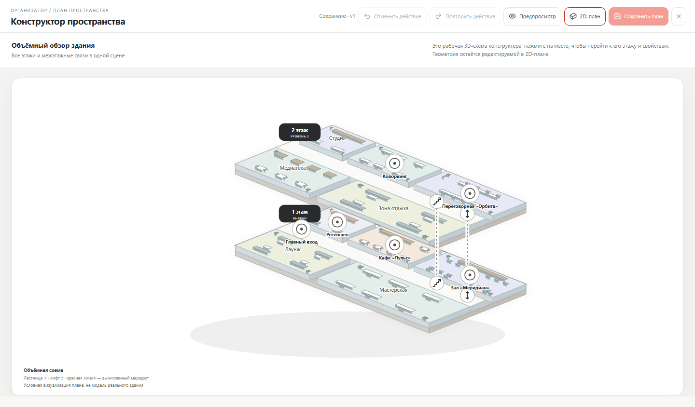
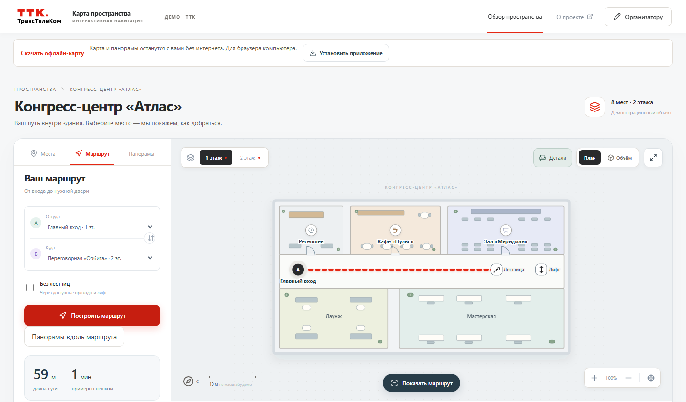

# Карта пространства

**Конструктор карт зданий и навигация для посетителей.**

Проект команды **No Name Team** по кейсу **ТрансТелеКома**. Организация создаёт собственное пространство, размечает этажи и проходы, добавляет панорамы и публикует карту. Посетитель открывает ссылку, находит место и получает маршрут.

[Открыть сервис](https://vladikgolosnoi.ru/) · [Посмотреть демо](https://vladikgolosnoi.ru/map/demo) · [Развёртывание](deploy/README.md) · [LiDAR](docs/LIDAR_ROOMPLAN.md)



## Возможности

- **Визуальный конструктор:** этажи, комнаты, двери, проходы, точки интереса, мебель и декорации; отмена действий и предпросмотр.
- **Навигация:** поиск мест, Dijkstra по графу проходов, межэтажные переходы и профиль без лестниц.
- **Панорамы:** загрузка готовых сцен, сшивка серии фотографий через OpenCV, привязка к карте и переходы между сценами.
- **Работа команды:** аккаунты, отдельные пространства, роли участников и серверная проверка доступа.
- **Публикация:** приватный черновик, отдельная опубликованная версия, постоянная ссылка и встраивание карты.
- **Мобильный интерфейс:** адаптивные панели и PWA. В репозитории также есть Android WebView и iOS-проект с RoomPlan.
- **Автономный просмотр:** HTML-экспорт демонстрационной карты с маршрутизацией и панорамами.

«Атлас» — вымышленный демонстрационный объект. Его размеры и доступность не являются результатами обследования реального здания.

## Быстрый старт

Нужны **Node.js 22.12+**, **Python 3.12** и npm. Версии зависимостей зафиксированы в `package-lock.json` и `backend/requirements.lock.txt`.

### Windows

```powershell
powershell -ExecutionPolicy Bypass -File scripts/setup.ps1
powershell -ExecutionPolicy Bypass -File scripts/start.ps1
```

Откройте `http://127.0.0.1:8000/`. На главной можно зарегистрироваться и создать своё пространство. Демо находится на `/map/demo`.

### Linux / macOS

```sh
python3.12 -m venv .venv
.venv/bin/python -m pip install -r backend/requirements.lock.txt
npm ci
npm run build
.venv/bin/python -m uvicorn backend.app.main:app --host 127.0.0.1 --port 8000
```

Для демо-организатора сервер создаёт случайный пароль в `backend/data/admin-password.txt`. Его можно заменить переменной окружения `SPACE_ADMIN_PASSWORD`. Пользовательские аккаунты создаются через регистрацию. База, медиа, пароли и `.env` не входят в репозиторий.

## Как пользоваться

1. Зарегистрируйтесь и создайте пространство в кабинете.
2. Добавьте этажи, помещения, двери и точки маршрута. Соедините их проходами; для лестницы или лифта задайте межэтажную связь.
3. Добавьте места и панорамы, проверьте маршрут в предпросмотре.
4. Сохраните план и опубликуйте сохранённую версию.
5. Поделитесь ссылкой посетителя или встроенной картой. Изменения черновика остаются приватными до следующей публикации.



## Стек

| Часть | Технологии |
|---|---|
| Интерфейс | React 19, TypeScript, Vite, SVG |
| API | Python, FastAPI, Pydantic |
| Данные | SQLite, файловое хранилище медиа |
| Панорамы | OpenCV, Pillow, Pannellum |
| Навигация | Dijkstra, явный граф проходов |
| Нативные клиенты | Java / Android WebView, Swift / RoomPlan / WKWebView |
| Проверки и размещение | pytest, Playwright, Docker Compose, Caddy |

```text
src/             интерфейс, редактор, карта и просмотр панорам
backend/app/     API, модели, маршруты, сшивка и хранение
backend/tests/   серверные тесты
e2e/             браузерные сценарии
android/         Android WebView-клиент
ios/             iOS-проект с RoomPlan
deploy/          HTTPS, контейнеры и резервное копирование
scripts/         установка, сборка и измерение производительности
```

## Разработка и проверки

Запустите API и Vite в двух терминалах:

```powershell
.\.venv\Scripts\python.exe -m uvicorn backend.app.main:app --reload --port 8000
npm run dev
```

Vite открывается на `http://127.0.0.1:5173/` и проксирует `/api` на backend.

```powershell
npm run build
.\.venv\Scripts\python.exe -m pytest backend/tests -q
npx playwright install chromium
npm run test:e2e:production
```

На Linux/macOS путь к Python: `.venv/bin/python`. Браузерные тесты запускают отдельные серверы и SQLite. Набор фотографий для дополнительных проверок сшивки загружается командой `python scripts/fetch-stitch-fixtures.py`; без него соответствующие проверки пропускаются явно.

## Статус и ограничения

Веб-сервис развёрнут на публичном сервере. Основной сценарий создания, публикации и просмотра проверяется API- и браузерными тестами.

- **LiDAR:** подготовлены iOS RoomPlan companion и веб-импорт JSON/USDZ. Xcode-сборка и сканирование на физическом устройстве ещё не приняты. Нужны Mac и совместимый iPhone/iPad с LiDAR. Браузер не запускает RoomPlan самостоятельно.
- **Android:** демонстрационная APK-сборка и подпись проверены; установка, камера и сохранение на физическом устройстве требуют приёмки. Пакет не опубликован в магазине.
- **Панорамы:** качество сшивки зависит от перекрытия, резкости и параллакса кадров. Частичный обзор сохраняет фактическое поле зрения.
- **Офлайн:** отдельный HTML-экспорт демонстрационной карты работает без сервера. PWA требует подключения для актуальных данных; пользовательским пространствам офлайн-экспорт пока не предоставляется.
- **Эксплуатация:** один процесс сервера и SQLite. Перед коммерческим запуском нужны подтверждение почты, восстановление доступа, квоты медиа, аудит действий и нагрузочная приёмка.

## Автор

**Владислав Голосной — No Name Team.** Кейс «Карта пространства», ТрансТелеКом, хакатон 2026.

Логотип и наименование ТТК принадлежат их правообладателям. Проект является конкурсным решением команды, а не официальным продуктом ТрансТелеКома. Публикация исходников сама по себе не предоставляет лицензию на товарные знаки и сторонние материалы.
